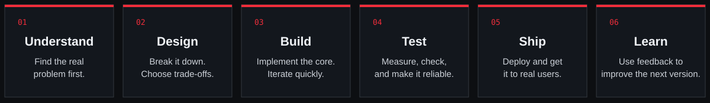
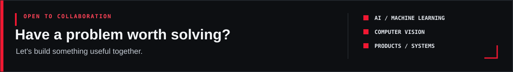

  
  
  

---

## About

I'm **Arjun**, a Computer Science and Engineering student at **SCTCE** (KTU '27) and **Tech Lead at CSI SCT SB**.

I'm a Python-focused developer who works across **AI/ML, computer vision, backend engineering, full-stack products, and distributed systems**. I enjoy turning practical problems into working software and learning by building.

## Focus areas

*Project highlights may include prototypes and work in progress. Visit the linked repositories for current implementation details.*

---

## GitHub contributions

---

## How I build

## Connect

  
  
  

Good ideas deserve good execution.

