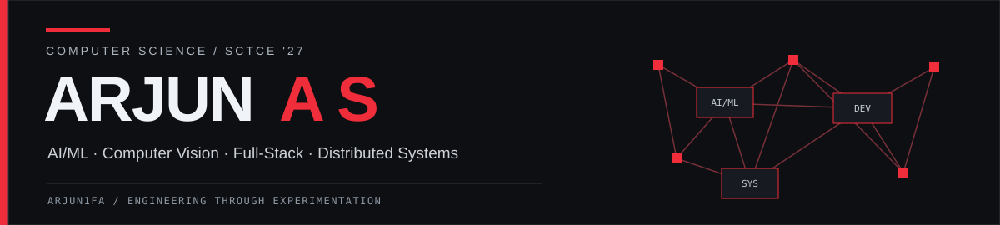
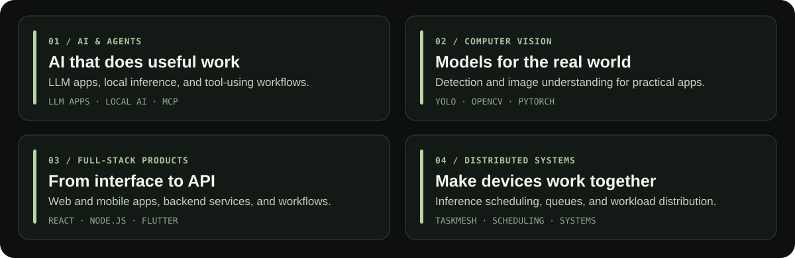
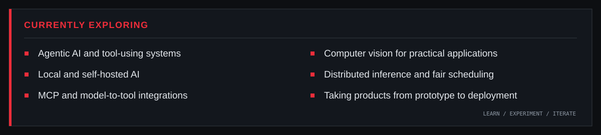
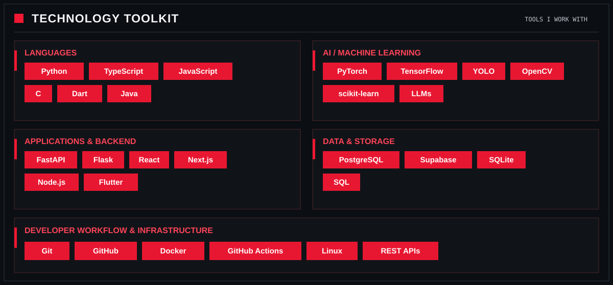
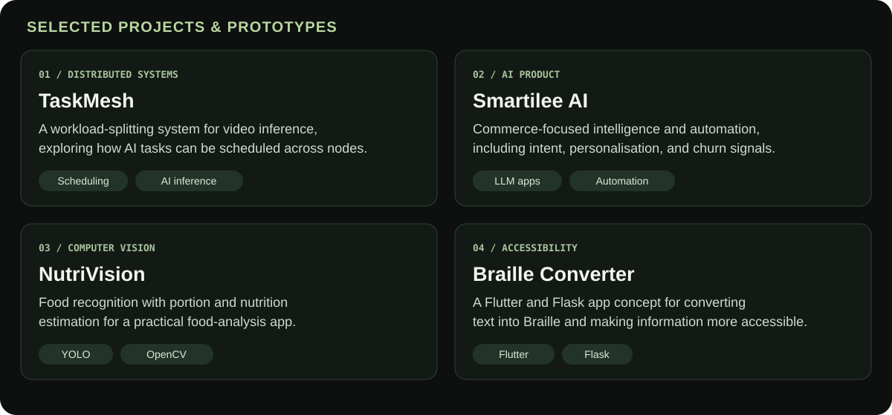

  
  
  

---

## About

I'm **Arjun**, a Computer Science and Engineering student at **SCTCE** (KTU '27) and **Tech Lead at CSI SCT SB**.

I enjoy building software that solves practical problems, especially where **AI/ML, computer vision, full-stack development, and distributed systems** meet.

My approach: understand the problem, build the useful core, test it with real constraints, and improve it through iteration.

## Focus areas

## Currently exploring

## Technology toolkit

## Selected projects

*These highlights include prototypes and work in progress; explore my repositories for the latest code and status.*

---

## How I build

**Understand → Design → Build → Test → Ship → Learn**

I care about good engineering, clear trade-offs, and creating tools that make someone's day a little easier.

## Connect

[GitHub repositories](https://github.com/arjun1Fa?tab=repositories) · [Email](mailto:culerarjun@gmail.com) · [Instagram](https://instagram.com/_winter.a_)
